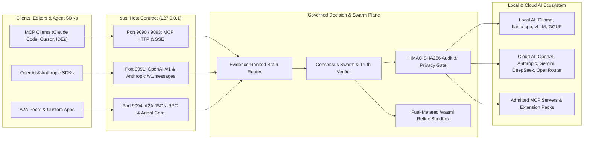

# Susi architecture: the socket, its pillars and what sits on it

This is the narrative architecture of the open Susi core: what the five-port
socket is, which pillars serve it, how the planes talk to each other inside
one host, how the commercial suite reaches core without linking it, and where
the lean-core program is taking the codebase. It was moved here from
`README.md` on 2026-11-08 (T-README-1) with its content preserved; the one
correction is the Wasm runtime statement, which now matches the code (see
"Sandbox" under the Tier S pillars). The enforceable crate-boundary contract,
checked by `tests/architecture_tests.rs`, stays in
[`ARCHITECTURE.md`](../ARCHITECTURE.md); the record of verified claims and
admitted gaps is [`docs/evidence.md`](evidence.md).

Scoped claim (Mandate 45): Susi is an evidence-gated agent-of-agents substrate
on your machine, not a replacement host OS and not a chatbot wrapper. "RSI"
is defined under "What RSI means here" below; it is a scoped claim, not a
statement that the baseline rewrites its own source unattended.

susi runs a persistent host daemon, bearer-authenticated HTTP, local and cloud inference behind one router, and agents that require evidence before declaring a mission complete. Native Windows uses MSVC and the Rust installer. Platform qualification is recorded in [Step 1 acceptance](step1-acceptance.md).

## Why developers build on `susi`

| Problem in today's AI stack | How `susi` solves it on one local socket |
|---|---|
| **Fragmented local & cloud APIs** | Point any OpenAI/Anthropic SDK, MCP client, or A2A peer at `127.0.0.1:9090–9094`. Route across local engines (`Ollama`, `vLLM`, `llama.cpp`, `GGUF`) and cloud APIs through one inspectable policy (`susi os route`). |
| **Opaque model routing & wasted spend** | Evidence-ranked **Brain** (`susi brain`) learns which provider succeeds per workload class (`reflex`, `chat`, `code`, `reasoning`), quarantines out-of-credit keys, and enforces `SUSI_BUDGET=low\|balanced\|max`. |
| **Hallucinated agent claims** | **Evidence-gated completion**: missions record live tool receipts (`EvidenceSession` / `ToolReceipt`), verify citations against the workspace, and seal actions into an append-only HMAC-SHA256 audit chain. |
| **Data egress & untrusted tools** | `local_only` privacy policy keeps model and tool traffic on this machine and its local network (internet egress blocked; the LAN stays reachable), and `host_only` on this machine alone (loopback only: no LAN, discovery, gossip, off-host peers or off-host clients); deterministic Tier-0 **Wasm reflexes** execute inside a fuel-metered `Wasmi` sandbox. |



The diagram names the runtime correctly: the reflex sandbox is Wasmi, a
pure-Rust interpreter with fuel, memory and output bounds. No Wasmtime, native
JIT or WASI-common runtime is linked anywhere in the workspace.

## Four core pillars on `susi-core`

| Pillar | Crate(s) | Role in the Open-Standards RSI AI OS Router |
|---|---|---|
| **GAWD** | `susi-gawd`, `susi-gawd-swarm`, `susi-gawd-agents`, `susi-gawd-a2a` | Evidence-gated multi-agent swarm consensus, A2A (`:9094`) protocol execution, truth verification, and Tier-0 Wasm reflex synthesis |
| **GEMI** | `susi-gemi`, `susi-gemi-models` | Unified local (Ollama, llama.cpp, vLLM, GGUF/Candle) and cloud (OpenAI, Anthropic, Gemini, OpenRouter) inference router (`:9091`) |
| **GMCP** | `susi-gmcp` | Standards-compliant MCP 2025-11-25 HTTP/SSE (`:9090` / `:9093`) and stdio server exposing governed host tools and resources |
| **Harness** | `susi-harness` | Unique parallel multi-agent self-build workflow: isolated worktree reservations, serialized combined-tree verification, and metered cost accounting |

Note (2026-11-08): the GEMI row still names GGUF/Candle because that was the
tree when it was written. The in-process Candle engine left core in the
lean-core program and is off in the default build (`local-engine` feature);
a default build serves local in-process inference only through a plug wired
on the plane bus (the commercial `susi-plug-host`), and otherwise routes to
the HTTP engines you run (Ollama, llama.cpp, vLLM, ...) or to cloud providers.
The record is in [`docs/lean-core.md`](lean-core.md) and
[`docs/evidence.md`](evidence.md).

> Mount models, agents, and MCP tools as capabilities — open OpenAI-compat / MCP / protocol-peer admission (config or `susi mcp-add` / `susi mcp enable`), including external coding agents and agent frameworks from an installed extension pack or `~/.susi/execution-agents/` adapter files via `susi agents` / `susi frameworks`, coding/agent models via `susi models`, top frontier engines via `susi frontier`, open-weight local hosts via `susi openweight`, OpenRouter via `susi openrouter`, and leading MCP tool servers from an installed extension pack via `susi mcp list|enable` when launchers/keys are present. susi orchestrates a consensus **Swarm**, grounds work in structured **Evidence** (`EvidenceRecord` / `Claim` + live receipts), cross-examines with a **Truth** transformer against workspace reality, cryptographically **audits** actions into an immutable HMAC chain, **sandboxes** untrusted Wasm plugins/reflexes (Wasmi, the pure-Rust interpreter inside the compatibility-named `susi-vendor-wasmtime` crate; no Wasmtime is linked) and optional shell (Docker), distills routine intelligence into **reflexes**, and reports a missing **MCP** tool as a typed capability gap (core never installs or launches one on its own). **Automation** is first-class via `susi automate <intent>`. Zero-config discovery runs on daemon start over what is already installed (engines / Candle fallback); it launches no third-party engine, CLI or MCP server (`tests/core_boot_starts_nothing.rs`). Core is a pure CLI plus standards socket: it ships no UI and bundles no plugin content; the desktop, any visual view and curated plugin packs live in Susi Commercial Apps. Install + optional API keys still apply.

## One operating layer, two AI ecosystems

- **Local AI OS layer** — discovers and manages local runtimes, GGUF/Ollama
  models, GPU/CPU placement, loaded-model lifecycle, MCP tools, sandboxed
  Wasm reflexes, workspace memory, and host-resident agents. `local_only`
  policy keeps traffic on this machine and its local network: it blocks every
  known internet-bound tool path, not only URLs with obvious network-shaped
  names, and leaves loopback, private, link-local and `.local` hosts open.
  `host_only` policy keeps it on this machine alone: only loopback targets,
  no discovery or gossip toward other hosts, no off-host peer calls, and
  off-host clients dropped by every listener whatever `bind_address` says.
- **Cloud AI OS layer** — admits OpenAI-compatible, Anthropic, Gemini,
  OpenRouter, MCP, A2A, and managed CLI peers through the same capability,
  budget, evidence, audit, and placement contracts. Credentials remain
  operator-owned; SUSI neither invents nor silently purchases access.
- **One decision plane** — a completion is placed locally, in cloud, or on an
  explicitly requested model by the same policy used by `susi os route` and
  the MCP `inference_placement` tool. The returned decision id resolves to its signed
  `INFERENCE_PLACEMENT` audit record, so routing is inspectable after the
  request instead of being an opaque provider choice.

### What RSI means here

Scoped claim (Mandate 1, Mandate 45). Recursive self-improvement is two
loops in the audited baseline; only one runs unattended. Full agent-owned
self-development is the required direction, not a claim that the baseline
already schedules unattended source rewrites.

- **Automatic: learning from receipts.** Successful execution receipts are
  staged as training samples; after each swarm mission SUSI checks the
  staged count and, past `reflex_training_threshold`, retrains its Tier-0
  neural reflex (`crates/susi-gawd/src/reflex_trainer.rs`). Checkpoints
  publish atomically with one last-known-good generation for recovery.
- **Gated: patching code.** `apply_patch_cycle` (`susi patch`, MCP tool)
  applies a workspace-confined patch, runs the test command, and rolls back
  on failure (`crates/susi-gawd/src/patch_cycle.rs`). It refuses to apply
  unless the request sets `auto_apply` or `trust_level` is `autonomous`.
  Nothing schedules it on SUSI's own source by itself (the former
  `susi-builder.yml` workflow was removed, CEO decision 2026-11-06).
  Mandate 48 keeps the installed `~/.susi/bin/susi` as the release toolchain
  that builds the next susi.

The drift audit (`evolution.rs`) suggests reflex candidates; it does not
write code. That describes current implementation, not a required human step.
Mandates 62–72 require agents to complete authorized self-development and prove
each upgrade locally; missing orchestration is engineering work, not completed RSI.

---

## Genome

susi's constitutional source of truth is machine-readable and **compiled into
the binary** at build time (`susi-gawd-agents` `build.rs` → `AlphaSelf`). The
ledgers live in [`.agents/`](../.agents/) — agent-governance data, not end-user
docs:

| File | Role |
|------|------|
| [`.agents/identity.json`](../.agents/identity.json) | Constitutional mandates, component topology, protocols (`susi/identity/v1`) |
| [`.agents/roadmap.json`](../.agents/roadmap.json) | Evolutionary vectors (`susi/roadmap/v1`) |
| [`docs/gmcp-roadmap.md`](gmcp-roadmap.md) | Standards-traceable GMCP completion program and task map |
| [`.agents/evidence.json`](../.agents/evidence.json) | Append-only mission / audit ledger (`susi/evidence/v1`) |
| [`.agents/tasks/`](../.agents/tasks/) | The shared task queue: one file per task, each with an acceptance command (`susi tasks`) |
| [`.agents/lanes/`](../.agents/lanes/) | Which agent works which learning-loop stage: one file per agent |
| [`.agents/schemas/`](../.agents/schemas/) | JSON Schema contracts for identity, roadmap and evidence |

When this README and `identity.json` disagree, source code wins and both are
updated in the same change.

---

## Host contract

Building a product on Susi? Start with [docs/integrating-with-susi.md](integrating-with-susi.md).

External clients can trust these ports — the daemon never silently drifts them. Verify an integration against a running host with `cargo run -p susi-conformance` ([docs/host-contract-conformance.md](host-contract-conformance.md)):

| Port | Surface |
|------|---------|
| **9090** | GMCP / MCP HTTP (`/mcp`; `/messages` alias) |
| **9091** | GEMI HTTP: OpenAI-compatible inference (`/v1/chat/completions`, `/v1/completions`, `/v1/embeddings`, `/v1/models`), Anthropic Messages (`/v1/messages`), Prometheus (`/metrics`), host identity (`/.well-known/susi`) |
| **9092** | A2A UDP discovery |
| **9093** | GMCP HTTP alias (streamable / SSE) |
| **9094** | A2A HTTP (`/` JSON-RPC, `/stream` SSE, `/.well-known/agent-card.json`) |

Swarm gossip UDP **9095** uses the same `port_offset` but is **not** in this table (`ports::SWARM_UDP`, `host_contract: false` on `susi os --json`). External MCP/A2A clients hard-code 9090–9094; **9092 stays A2A discovery**. Gossip is cluster-member traffic.

- **`global susi`** — background daemon bound to the host substrate (`~/.susi`), not to a project folder.
- **`susi` CLI** — jailed to the caller's cwd; intents run against that workspace while the daemon owns ports, models, and lock state.
- **Canonical binary** — `~/.susi/bin/susi` (hot-reloads when the binary hash changes).
- **Control plane** — `susi start` / `susi stop` / `susi restart` are deterministic host commands (never missions). `start`/`restart` wait until the host-contract ports are ready and print the endpoints.
- **Zero-trust HTTP** — daemon seeds `~/.susi/api_token` (0600, regular file, `O_EXCL` install — a symlink, empty file, or unreadable path aborts startup before any port binds); clients must send `Authorization: Bearer <token>` on every HTTP contract port (except `/health` / CORS preflight). Leaf services and spawned cells are never started without the persisted token.

**Port layout (`port_offset`)** — the five contract ports shift together, never
individually (per-port overrides caused a real scramble once, so the relative
shape is compile-time): `port_offset` in `config.json` (or `SUSI_PORT_OFFSET`
env, which wins) moves all of them — offset `100` → `9190–9194`, and the leaf
services shift too (`18080–18084` → `18180+`). LAN discovery announces the
effective GMCP port in its pong, and signed pings carry `gmcp_http=` — peers
on a different offset are still found and reachable; `peers add` against a
nonstandard layout takes `host:port` explicitly. A *second instance on one
host* needs its own root as well as its own ports: `SUSI_HOME=~/.susi-b`
isolates config, lock, and state — `SUSI_HOME=~/.susi-b SUSI_PORT_OFFSET=100
susi start` brings up a complete sibling node.

**When a canonical port is busy.** 9090 is also the default port of the
Prometheus server, and 9092-9094 are the ports Kafka brokers commonly listen
on, so a developer machine often has one of them taken. The daemon binds six
ports as one block, the five contract ports and gossip 9095
(`crates/susi-daemon/src/port_fallback.rs`). Before it binds, it probes each
with a real bind on every address it will use, offers each held port to the
stale-susi reclaim (only a susi process of this instance with the trusted
binary hash is evicted), and then:

- **Offset pinned** (`SUSI_PORT_OFFSET` set to any value, `0` included, or a
  non-zero `port_offset` in `config.json`): the pinned block is bound exactly.
  If a foreign process holds one of its ports the start refuses with
  `Fatal: canonical port <n> is unavailable ...`, as it always has.
- **Nothing pinned**: when a foreign process still holds one of the six, the
  daemon serves the whole block at the first offset `k * 100` (`k` = 1..=20)
  where all six bind, and logs `canonical port <n> (...) held by pid <p>
  (<image>); serving the host contract at offset <k*100>: ports ...`. No free
  block up to offset 2000 refuses the start, naming the holder and
  `SUSI_PORT_OFFSET`.

The chosen offset is set as `SUSI_PORT_OFFSET` in the daemon's own
environment before any worker or leaf service starts, so the whole process
tree agrees on it, and it is published in `<config dir>/ports.json` with
`offset`, `pid` and `fallback_from` (the configured offset; it differs from
`offset` exactly when the daemon fell back). Clients resolve the offset in one
order, `SUSI_PORT_OFFSET`, the explicit config key, the live daemon's
`ports.json`, then 0 (`susi_paths::ports::resolve_offset`). A `ports.json`
counts only while its pid holds the instance's substrate lock (on Windows the
OS byte-range lock on `substrate.lock`, on Linux a live `/proc/<pid>`), and the
daemon removes it on a clean stop, as does `susi stop`. The fallback is
deterministic for the host's state, uniform and announced: a client that
hard-codes 9090 reaches it only when the canonical block is free, which is
why the start banner and `susi os status` say when a fallback is in effect.

---

## Plane bus and the loopback rendezvous

Inside one host the planes do not call each other through Cargo edges. They
meet on `susi_core::plane_bus`, a topic-addressed request/stream bus: a plane
registers handlers for exact topics or topic prefixes, and a caller issues
`PlaneBus::request(topic, json)` or opens a stream. `susi crown` checks that
the GAWD, GEMI, tools and agents planes are each wired on it.

The bus has an IPC backend, `crates/susi-core/src/plane_bus_ipc.rs`, so the
same wire semantics hold across processes (`susi-gawd`, `susi-gemi`,
`susi-gmcp`, the daemon, the CLI and test binaries each own a
`PlaneBus::global()`):

- `register` / `register_prefix` lazily bind a `127.0.0.1:0` listener and
  publish the endpoint under `<cache>/bus/<pid>/` (`topics/<encoded topic>`,
  `prefixes/<encoded prefix>`), a filesystem rendezvous scoped to the owning
  process, behind a per-substrate secret in `<cache>/bus/secret`.
- `request` resolves a topic to an endpoint file and POSTs the JSON payload
  (`POST /handle` answering `{ok}` or `{err}`); exact topic files are tried
  before prefix files, the same order as the in-process lookup, and every
  numeric-named sibling pid directory under the root is scanned, so a handler
  published by any process under that root answers.
- `open_stream` embeds the caller's endpoint in the stream id
  (`ipc://<addr>/<id>`) so `stream_emit` reaches the right process from
  anywhere; the `/stream` endpoint feeds the local receiver.
- Stale endpoint files are pruned on connect failure; dead pid directories are
  swept on init where `/proc` is available. Requests are bounded (64 KiB head,
  64 MiB body, 256 concurrent connections, 200 ms connect timeout to loopback).

The cache root follows one rule: `SUSI_HOME` is the whole instance root; else a
legacy `~/.susi` keeps everything in that root; else the per-OS cache dir
(Windows `%LOCALAPPDATA%\intellibitz\susi\cache`, Linux `$XDG_CACHE_HOME/susi`
or `~/.cache/susi`).

## The plug bridge to the commercial suite

CEO decision 2026-11-08 ("Socket bridge"): commercial capabilities reach the
running open core over the bus rendezvous above, not by linking core's crates
into a commercial binary. Core publishes the ports; the commercial repository
(`intellibitz/susi-commercial-apps`, its `docs/plug-bridge.md`) ships
`susi-plug-host`, a std-only process that joins the rendezvous as its own pid
directory with the secret core minted, answers core's wire format exactly, and
serves the capabilities core gave up in the lean-core program:

| topic (published by core) | core caller | served by (commercial) |
|---|---|---|
| `gpu_fabric.local_engine.*` | `susi-gemi` `local_plug` | `susi-gpu-fabric` local-engine plug |
| `ecosystem_hub.mcp.call`, `ecosystem_hub.mcp.list_tools` | `susi-tools` MCP client | `susi-ecosystem-hub` MCP plug |
| `gpu_fabric.embed.texts`, `gpu_fabric.embed.install` | `susi-gmcp` `embed_provider` | `susi-gpu-fabric` embedding plug |
| `desktop.browser.capture` | `susi-gmcp` `browser_automate` | `susi-desktop` page capture |

Rules that hold on both sides: a plug host never mints the bus secret (with no
secret under the root, core has not run there and the host refuses to join);
core's `is_wired(topic)` decides whether a capability is served, and an
unserved one is reported as a typed capability gap, never faked; a killed host
leaves endpoint files that core prunes on its next failed connect. A second
isolated instance is `SUSI_HOME=<dir> SUSI_PORT_OFFSET=100 susi start` with
`SUSI_HOME=<dir> susi-plug-host`.

---

## Foundation pillars (Tier S)

Every pillar below is a **Tier S** crown USP — must hold in source and pass `susi crown verify`:

1. **Truth** — models never certify. Cited answers resolve through the live
   receipt ledger, and narrative fails when the mission captured receipts it
   should cite; an answer with nothing to cite is returned with a visible
   "No citations found" warning, not as verified truth.
2. **Evidence** — `EvidenceSession` / `ToolReceipt` ledger; no naked assertions.
   Overlapping missions on one workspace no longer strand the earlier one's
   ledger: activations stack, and a finishing mission hands ownership back.
3. **Swarm** — agent-of-agents consensus (GAWD); `susi crown` checks that the
   GAWD, GEMI, tools, and agents planes are each wired on the plane bus.
   DAG task agents run fenced `bash`/`sh`/`shell` blocks through the governed
   `exec_command` tool with the tag parsed exactly, and each node's evidence
   binds to its own command's receipt, never another node's.
   Cluster identity files are installed atomically; an interrupted first
   start no longer leaves an empty `cluster.key` that strands the node.
   Operator bans fail closed: a damaged `peers_banned.json` refuses membership
   and is never overwritten, rather than reading as empty. The verified
   roster (`peers.json`) is likewise never rewritten from a damaged read,
   including from `susi peers`, which reports the damage instead.
4. **Blackboard** — live shared state (`.susi/last_blackboard.json`, redacted
   with the shared credential redactor and replaced atomically).
   The context graph (missions, tool calls, patch cycles, observations) is
   bounded, compacted by atomic rename, and re-read correctly by sibling
   processes after a compaction; compaction is skipped, never run unlocked,
   when the cross-process lock is unavailable.
5. **Glass box** — inspectable traces / blackboard / governance / crown reports (Mandate 26; secrets redacted, not naked).
   The blackboard, governance, and mission-trace files all pass through the
   shared credential redactor and are replaced atomically.
   Interaction memory (`memory.jsonl`, `reasoning_experience.jsonl`) is
   redacted the same way; experience entries are labeled by the heuristic
   that promoted them, not as semantically validated.
   The context graph itself redacts every observation, label, and payload
   string on record, so no adapter can persist a raw credential there.
   Error metrics are redacted too: credentials in error text (env-held keys,
   bundled token patterns) are masked before `error_metrics.jsonl` records them;
   every writer shares one owner-only, instance-aware sink.
   Task listings reflect real outcomes: a task whose owner exits without
   reporting one is recorded as `[ABANDONED]`, not left `Running`; finished
   records are pruned oldest-first past 512 so the daemon's table stays bounded.
   The watchdog's idle lease per task category is learned from the measured
   gap between progress reports, not a constant, and persisted atomically.
   Agent commands count as progressing only when they produce output, so a
   hung command is reaped instead of looking busy forever.
6. **Audit** — append-only HMAC accountability chain; cross-process writers
   serialize, complete JSONL records are emitted in one write, stale tip
   checkpoints rebuild from the verified log, and unreadable input fails closed.
   Recent-activity readers (drift audit, the GMCP `sovereign_dashboard` report tool, placement-decision lookup) read only the log's tail.
7. **Zero-config Auto** — Mandate 44; `susi auto`; host installs/keys still gate cloud.
   First-run host config comes from the defaults compiled into the binary,
   never from a `config.default.json` in whatever directory SUSI runs in.
8. **Governance-first** — Safety/Security before parallel fleet.
   The safety veto catches recursive removal of `/` or home in any flag
   spelling (`rm -fr /`, `rm -r -f ~`, …); content checks stay pattern-based.
   Critical system paths match whole components, so `~/dev/myapp` or
   `docs/bootstrap.md` are not mistaken for `/dev` or `/boot`.
   Destructive and exfiltration patterns likewise match whole commands
   (`rsync -e ssh` is not `nc -e`).
   The security veto rejects any action carrying the value of a credential
   the host holds (`*_API_KEY` / `*_TOKEN` / `*_SECRET`), whatever its prefix.
   Secret patterns match only at a token start, so words like `risk-assessment`
   are neither vetoed nor redacted.
   The privacy posture fails closed: a damaged `privacy_mode` file enforces
   `local_only` instead of silently reading as `balanced`.
   Under `local_only`, the HTTP inference provider itself refuses to send
   prompts or embedding text to any endpoint off the host/LAN (off the host
   alone under `host_only`, where no grant reopens egress), and model
   downloads (including the background starter-model download) and admitted search tools
   (Brave/Google/`web_search`), external peer agents,
   proxy endpoints, crates.io scouting, cloud coding agents (Devin/Manus), and
   Hugging Face catalog discovery, and remote MCP servers over HTTP need
   egress consent; host/LAN targets are always allowed.
   Scoped capability grants stop at a path/host boundary: a grant on
   `/srv/ws` never authorizes `/srv/ws2`.
   Local agent messaging (`ipc_send`) is authorized by the default
   `app://*` transmit grant; the broker still checks per-sender dispatch grants.
9. **Pluggable** — admission protocols: `CapabilityRegistry` + installed extension packs (core ships and seeds none); managed catalog commands (`models` / `frontier` / `openweight` / `agents` / `frameworks` / `mcp` / `openrouter`) read compiled model catalogs and whatever installed packs provide.
   Core never enables, configures or launches a third-party MCP server on its
   own: a server runs only after an explicit `susi mcp-add` / `susi mcp enable`
   (servers an earlier core enabled on its own stay in `mcp_config.json` until
   removed; `susi mcp list` shows them and `susi mcp disable <id>` removes them).
   Admitting an MCP server refuses a damaged or unreadable `mcp_config.json`
   instead of rewriting it as only the server being added.
   A damaged extension-pack `state.json` is never rewritten: startup runs on
   compiled defaults and load/unload refuse until the operator repairs it.
10. **Sandbox** — Wasmi for Wasm: the pure-Rust interpreter inside the
    compatibility-named `susi-vendor-wasmtime` crate runs both the Tier-0
    reflexes (`wasm::execute_reflex`) and the daemon's crown sandbox probes
    (`execute_untrusted_wasm`, `crates/susi-daemon/src/crown.rs`, check id
    `sandbox_wasmtime`, a historical identifier) with bounded fuel, memory
    and output and a capability-limited WASI; no Wasmtime, native JIT or
    WASI-common runtime is linked (`Cargo.lock` holds `wasmi` and no
    `wasmtime`, pinned by a test in that crate). Docker `sandbox_exec` when
    available.
    Self-patch cycles (`apply_patch_cycle`) are all-or-nothing: every file is
    checked before any write, and write, spawn, or test failure rolls back
    through one transaction snapshot (the only workspace-rollback mechanism;
    an unused whole-workspace copy routine was removed). Transaction ids are reserved on disk
    so concurrent processes never overwrite each other's rollback snapshots,
    and a transaction can only be closed against the workspace it snapshotted.
11. **Host contract** — canonical ports 9090–9094, uniformly shiftable via `port_offset` / `SUSI_PORT_OFFSET`. Swarm gossip 9095 uses the same offset but is swarm-internal (`ports::SWARM_UDP`), not part of the published five-tuple (9092 remains A2A UDP discovery).
    HTTP rate limits bucket IPv6 clients per /64, so rotating addresses
    within one allocation does not reset the budget.
    The daemon's binary trust anchor hashes the whole binary (a read error
    fails instead of truncating the digest) and is replaced atomically.
12. **Reflexes** — Wasm reflexes under the data dir (synthesized modules are
    compiled to a staging name and renamed into place, never half-written);
    automatic native
    distillation fails closed on unreadable staging/configuration, training
    failure, or failure to retire consumed samples. Training is cross-process
    serialized, consumes the invoking workspace's staged experience, and
    resumes from the globally published weights. Corpus records must be valid
    JSON with a non-empty intent and an exact registered action label; automatic
    staging happens once at successful receipt capture and pairs the action with
    the credential-redacted mission from that same live evidence session. The
    model persists an append-only action vocabulary beside its weights so new
    ecosystem capabilities cannot reorder learned output labels; the vocabulary
    records the exact weights SHA-256 and mismatched pairs fail closed. New
    immutable checkpoint generations become active through one atomic manifest
    update, so interrupted training cannot replace the last active bundle; the
    manifest retains one validated previous generation for automatic fallback.
    Generations older than active plus previous are pruned after publication;
    cleanup failures are returned as training warnings.
    Training atomically claims a staging snapshot, leaving concurrently captured
    receipts in the live buffer; failed training restores the claim ahead of them.
    A workspace training lease prevents claim theft, and crash-orphaned claims
    recover oldest-first before the next cycle.
    Archived receipts record whether each training sample was staged, and
    drift audits and training reports include that staging-health line.
    Claimed buffers drop torn or blank lines and train only when the
    remaining samples still meet the threshold; a claim with nothing
    usable left is discarded. Records with a blank intent or an action
    outside the vocabulary are skipped and reported, so one unlabelable
    sample cannot fail the batch every cycle.
    Drift audits report reflex latency violations and logged `*_FAILED` /
    `*_VIOLATION` / `*_DETECTED` events by type, and an idle trainer says
    training is not due rather than calling the substrate "optimal".
    When no reflex tier answers, the request escalates to deep reasoning
    (cloud/discovered providers) instead of returning a cached apology; the
    reflex cache is keyed per workspace and bounded. The published model is
    loaded once and reused until its bundle is republished.
13. **Provision** — daemon bootstrap + auto-prime + Candle/weight ladder.
    Supervised leaf services back off only on real crash loops: a service
    that ran stably for 10 minutes before dying gets a fresh restart budget.
    No distilled "Tier-2 reasoning" weights or vision/audio encoders are
    claimed: native inference loads GGUF (llama/qwen2); everything else runs
    on real local (Ollama/vLLM) or cloud LLMs over HTTP.
    Note (2026-11-08): the in-process GGUF engine named here left core in the
    lean-core program (ungated iterations 341-347, no destination on the
    commercial origin); `tests/zc_matrix.rs` keeps its two runtime tests
    ignored by CEO decision until a plug or the restored engine is in. The
    default build routes local inference as described under the pillar table.
14. **Concurrency-first** — Tokio / Rayon / Crossbeam / parking_lot.
    Note (2026-11-08): the pillar crates now use std sync primitives and
    `susi_core::parallel` (std scoped threads) where they used parking_lot,
    dashmap, flume and rayon; the wave log in `docs/lean-core.md` records each
    replacement.

Verify: `susi crown` (exit non-zero if any critical USP fails).

---

## Lean-core direction

CEO directive 2026-11-07: Susi core is minimal. GAWD, GEMI, GMCP and the
harness (with its parallel multi-agent workflow) are the only components; it
compiles, builds, tests, runs and debugs anywhere with nothing but Rust, and
everything that is not one of those four is a plug that lives in
`susi-commercial-apps` and is admitted over the socket. The plan, the measured
ladder and the crate classification are in [`docs/lean-core.md`](lean-core.md);
its ceilings are pinned by `tests/lean_core_ceilings.rs` and may only go down.

Where it stands on 2026-11-08:

| measure | 2026-11-07 start | now |
|---|---|---|
| third-party crates compiled for the four pillars | 331 | 259 |
| workspace crates compiled for the four pillars | 59 | 50 |
| vendor facades named directly by the pillar crates | 26 | 23 |
| cold `cargo build -p susi`, wall clock, idle machine | 165 s (196 s under load) | 81.7 s on landed `240ee4dfb` |
| rustc CPU-seconds, all units | 1,872 s (471 units) | 822.7 s (417 units) |
| budget | | 60 s wall |

The rungs, in order: product debt out of the pillar closure (crate-level
migration to commercial plugs); framework facades replaced by a std-only
loopback HTTP/1.1 and JSON-RPC socket; the last dependencies (serde kept or
vendored, a CEO decision at that rung); a clean offline clone. The compile
budget's current critical path is windows-sys, tokio, hyper, then the serial
pillar chain (core, gawd-agents, gawd-swarm, gawd, daemon, bin); the next
levers are the MCP server facade, the tokio/hyper stack, the Win32 surface and
derive-free serde. Wall is the noisiest number: quote it only with the run it
came from.

---

## Operating the socket: command reference

```bash
# Bring up / tear down the host daemon (control plane — not a mission)
susi start
susi stop
susi restart

# Task across the agent swarm (cwd = workspace)
susi "analyze this workspace and propose an optimization plan"

# One plain-text operator snapshot, printed once; --json for machines
susi top
susi top --filter providers
susi top --json

# Identity / status
susi identity
susi status

# Explain the live local-vs-cloud placement decision (same policy the runtime uses)
susi os route
susi os route --requires vision --max-cost 0.01
susi os route --no-cloud
susi os route-reset openai-gpt-4o-mini # after repairing credentials/connectivity
susi os provision probe
susi os provision list kubernetes
susi os provision apply kubernetes ./cell.yaml

# Cloud keys (peer of models) — env or ~/.susi/cloud.env
susi keys set openai          # prompts, or pipe the key on stdin
susi keys list
susi keys prefer deepseek
susi keys check               # one read-only /models call per vendor: valid / rejected / missing
susi keys models fireworks    # the models a vendor serves right now

# Local AI ecosystem: what is installed, what is running, what the hardware can host
susi ecosystem scan           # hardware, engines (Ollama, llama.cpp, vLLM, …), GPU backends
susi ecosystem start ollama   # only engines that need no model choice; core never starts one at boot

# The brain: which model susi trusts for which kind of work, and why
susi brain
susi brain classify "fix this bug in my parser"

# Building susi: agents follow AGENTS.md in isolated worktrees
cargo local-workflow list
cargo local-build debug
# Production candidates require passing policy gates; never overwrite production

# Automation (evidence-gated swarm mission)
susi automate "refactor the auth module and verify with tests"

# Open-admit any MCP server (stdio or HTTP URL)
susi mcp list                      # catalog of the installed extension pack (empty without one)
susi extensions load <pack>        # then: susi mcp enable <id>
susi mcp-add remote-http http://127.0.0.1:3100/mcp

# Point external MCP / HTTP clients at the host contract
#   http://127.0.0.1:9090/mcp
#   http://127.0.0.1:9091/
#   http://127.0.0.1:9093/mcp
# Bearer required (except /health):
#   Authorization: Bearer "$(cat ~/.susi/api_token)"
# Read-only placement contract for remote operators and cloud control planes
# (MCP tools/call on 9090/9093):
#   inference_placement {}
#   inference_placement {"requires": "vision", "max_cost": 0.01}
#   inference_placement {"allow_cloud": false}
# Completion requests may execute the same plan with
#   "susi": {"requires": "vision", "max_cost": 0.01, "allow_cloud": false}
# `allow_cloud:false` pins execution to a ready local model and fails with
# HTTP 503 when none is ready. It also rejects an explicitly pinned cloud
# model instead of weakening the request. Successful completion responses
# report `X-Susi-Placement: local|cloud|explicit` and
# `X-Susi-Placement-Id: placement-...` (both CORS-exposed), plus a
# `susi_placement` object in JSON responses and the opening SSE frame.
# Resolve that id to the signed decision record:
#   placement_decision {"decision_id": "placement-..."}
# Runtime model cache and provider recovery are MCP tools too:
#   runtime_models_list, runtime_models_load, runtime_models_unload,
#   inference_reset_provider
```

Remote access / HTTPS — every socket sniffs each connection's first byte, so
the same ports serve plain HTTP *and* HTTPS (a TLS ClientHello upgrades when
a certificate is configured). The contract:

- **Sniffing, not separate ports** — `https://host:9091` and
  `http://host:9091` coexist, so TLS-terminating reverse proxies and
  mixed-version peers keep working.
- **Remote plaintext is always refused**; loopback is always exempt so
  internal `http://127.0.0.1` callers never break. The retired keys
  `https_only` and `allow_remote_plaintext` are ignored (a leftover
  `https_only`, or `allow_remote_plaintext: true`, logs a one-time notice). Susi machines never talk to each other on these ports:
  every call between machines travels inside the sealed peer channel on its
  own port (`peer_channel_listen`, default 29090; `docs/peer-channel.md`),
  authenticated by the node keys, and no bearer ever leaves the host.
- **Auto self-signed**: a non-loopback `bind_address` with no configured cert
  generates `~/.susi/tls/cert.pem` on start — remote clients use `curl -k`
  or pin the cert. For browser-trusted HTTPS, supply a real cert via
  `tls_cert_path`/`tls_key_path` (e.g. Let's Encrypt).
- **Dual-bind**: a specific `bind_address` (e.g. a LAN IP) binds loopback
  *alongside* it, so local callers are never stranded. `0.0.0.0`/`::`
  already cover both.

```jsonc
{
  "bind_address": "0.0.0.0",         // listen beyond loopback (default 127.0.0.1)
  "tls_cert_path": "/path/cert.pem", // optional: real cert (e.g. Let's Encrypt)
  "tls_key_path": "/path/key.pem",
  "peer_channel_listen": "0.0.0.0:29090" // a hub: accept sealed peer-channel links here
}
```

Stdio MCP for editors that prefer a subprocess:
```bash
susi mcp
```

---

## Local and cloud AI ecosystem

susi is hardware-aware at startup and manages the AI you already run.

- **Local.** At bootstrap it inventories the hardware profile and the GPU
  backends it finds evidence of (CUDA, ROCm, Metal, Vulkan, oneAPI) together with
  the installed local engines and model stores: Ollama, llama.cpp,
  vLLM, SGLang, LocalAI, Jan, GPT4All and the
  Hugging Face cache — installed, running, endpoint, version, and whether susi can
  start it. The result is saved to `~/.susi/local_ecosystem.json`; `susi
  ecosystem scan|status|start <id>` shows it. `start` only launches engines that
  need no model choice. Engines on non-default ports: `SUSI_ENGINE_PORTS=jan=1400,ollama=11435`.
  Running engines join inference routing automatically.
- **Cloud.** OpenAI, Anthropic, Gemini, DeepSeek, xAI, Together, Fireworks,
  DeepInfra, Groq, Mistral, OpenRouter and others are keyed with `susi keys`.
  `susi keys check [vendor]` makes one read-only `/models` call per vendor and
  reports valid / rejected / rate-limited / missing / unreachable and whether the
  configured default model is still served; `susi keys models <vendor>` lists what
  a vendor serves now. A key check proves the key, not that the account has
  credit — the brain learns that from real calls.


susi drives external autonomous agents with the keys you registered (`susi keys set <vendor>`); nothing is provisioned for you. Core bundles no agent catalog: execution-catalog entries come from an installed extension pack (`execution-agents.json`) or an adapter file under `~/.susi/execution-agents/<id>.json`, and run through the managed-agent manager. Typical entries a pack provides:

| Entry | Transport | Notes |
|---|---|---|
| `openhands` | headless CLI | registered provider key is mapped to `LLM_API_KEY` / `LLM_BASE_URL`; an explicit `LLM_API_KEY` always wins and no model is chosen for you |
| `openhands-server` | OpenHands app-server / Cloud REST (`/api/v1/app-conversations`) | `OPENHANDS_API_KEY`; cancel pauses the sandbox; follow-up messages are refused because the API documents none |
| `gemini-acp` | Agent Client Protocol over stdio | any ACP agent by overriding program/args; tool permission requests are denied unless `SUSI_ACP_AUTO_APPROVE=1` |
| `a2a` | outbound A2A JSON-RPC | override `url` (and `token_env`) to point at any A2A agent; card discovery, 0.3 and 1.x wire dialects |

Run any of them with `susi agents run <id> --wait "<task>"`; `susi agents doctor <id>` checks prerequisites without spending anything. A failed local task reports the first and last stderr lines (credentials masked) in its `error` field.

## The brain: evidence-ranked model selection

susi does not trust a fixed vendor order. It learns which model to trust, per
kind of work, from what actually happened.

- **Per task class.** Every inference call records, per provider and per class
  (`reflex`, `chat`, `code`, `reasoning`), whether it answered and how fast
  (`~/.susi/brain_evidence.json`). Providers are tried best-first for the
  prompt's class. **Local is the floor, cloud is the ceiling:** with no evidence,
  hard work leans to cloud models and reflex-sized work to local engines, and
  evidence overrides that lean.
- **Missions teach it.** Each mission is tagged (a non-citable `brain:*`
  receipt) with the providers that answered it; its verified outcome
  (`SUCCESS`/`COMPLETE` vs failed, governance blocks skipped) is folded back
  into their record once per mission.
- **A failed or unfunded model can never be the brain.**
  - A no-credit or rejected-key failure (HTTP 402/401/403, "insufficient
    balance") quarantines the vendor's whole credential scope on a ladder:
    10 minutes, 1 hour, then 6 hours. A provider with poor evidence and a recent
    failure sorts behind every healthy one, **even if it is your sticky preferred
    cloud**.
  - If the preferred cloud is the one that failed, susi moves the preference to
    the best healthy cloud (remembering yours as `auto_switched_from`), gives the
    original one trial call whenever its quarantine lapses, and restores your
    preference the moment it answers. `susi keys prefer <vendor>` always wins.
  - The streak clears on its first successful call, on `susi keys set <vendor>`
    (a new key is the repair) or on an operator reset. **Keys are never removed
    or disabled by a failure**, so you can top an account up at any time.
  - Transient trouble (rate limits, network) keeps the short cooldowns.
- **Cost is a factor evidence outweighs.** Providers sit in coarse
  marginal-cost tiers (`free`/`low`/`mid`/`high`; defaults in
  `config/cost-tiers.json`, override in `~/.susi/cost_tiers.json`). A tier step
  costs a candidate a lot for reflex work and little for hard reasoning.
  `SUSI_BUDGET=low|balanced|max` turns the dial (`max` ignores cost).
- **Hard filters come first.** Privacy policy, budget ceilings and cooldowns are
  applied before ranking; the brain only orders what survives them.

`susi brain` shows the ranking, budget, preferred cloud, failure streaks and
cooled providers; `susi brain classify "<prompt>"` shows how a prompt is routed;
`susi brain reset` forgets the history.

## Extension packs

Core is **protocol-generic** (admit/run/doctor/enable + registries). Vendor opinions — launchable catalogs (MCP servers, agent adapters), cloud env alias overrides, ranks — live in **extension packs**, which core never ships or seeds; the user or the commercial desktop installs them. Lifecycle:

- **Install** — a pack is `~/.susi/extensions/<id>/` with a `manifest.json` (core writes none on its own)
- **Discover / load** — installed packs are discovered and marked loaded; `susi extensions load <id>` verifies checksums/signatures and activates one; `state.json` tracks the active id
- **CLI** — `susi extensions` / `susi ext` (`list`, `status`, `create <id>`, `load <id>`, `unload <id>`, `validate <dir>`)
- Manifest schema: [`docs/extension-pack.md`](extension-pack.md)
- Force active pack: `SUSI_EXTENSION_PACK=<id>`

Model catalogs and cloud-vendor aliases are compiled defaults (offline boot); the active pack's files win when present. Launchable catalogs have no compiled default: with no pack they are empty. See [`config/README.md`](../config/README.md) for which file is authoritative (bootstrap MCP ≠ leading MCP ≠ scout registry).

Editorial model catalog **views** stay separate JSON files under `config/` (not one mega-catalog): `coding-models.json`, `frontier-models.json`, `open-weight-models.json`, `openrouter-models.json`, plus `models.catalog.default.json` for the broader ladder. Host overrides live under `~/.susi/{coding-models,frontier-models,open-weight,leading-mcp}/` and preserve unknown keys on configure (Mandate 35).

---

## Design principles

Defined in `.agents/identity.json` (`design_principles`):
- **Autonomous by default** — Mandate 46; plan and execute via swarm consensus, not step-by-step babysitting; evidence-gated and governance-first (not “100% automation”).
- **Grounded outputs** — claims checked against tools and workspace state.
- **Traceable reasoning** — Mandate 26; thinking and tool calls are inspectable (`.susi/last_mission_trace.json`, `.susi/last_blackboard.json`); not “100% transparency” of secrets or vendor internals.
- **Concurrency-first** — Tokio, Rayon, Crossbeam, parking_lot on real hardware (Mandates 5, 28–30; lock-preferring, not “zero blocking forever”).
- **Rust-only implementation** — runtime, tooling and shipped dependency closure must be Rust (Mandates 43 and 63); incompatible existing components remain migration defects.
- **Zero-config auto** — boot primes preferences from what is already installed (coding models; execution agents from installed packs) without hand-edited config (Mandate 44); it enables or launches no MCP server, engine or peer on its own; agents own technical setup; credentials and paid-service consent remain explicit gates.
- **OS layer for AI agents** — agent-of-agents substrate on the host (Mandate 45); not a replacement host OS.
- **Native installation** — verified artifacts and native provisioning without a Windows shell/emulation prerequisite (Mandates 47 and 64); legacy installer scripts are migration work.
- **Release-only self-build** — the installed susi is the toolchain that builds the next susi (Mandate 48). Dev builds verify on an isolated dev instance, and only locally qualified, health-checked promotion may replace `~/.susi/bin/susi`. This is a promotion discipline, not “releases can't break.”

Crate boundaries, composition roots, ports, and the admission protocols are documented in [`ARCHITECTURE.md`](../ARCHITECTURE.md) (enforced by `tests/architecture_tests.rs`).
